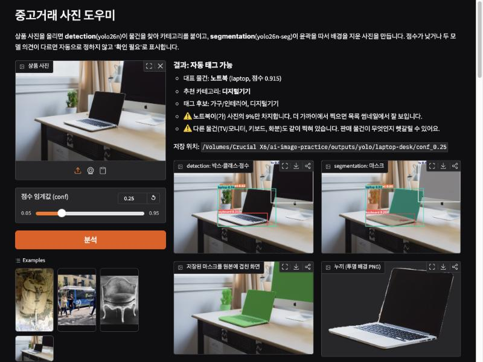
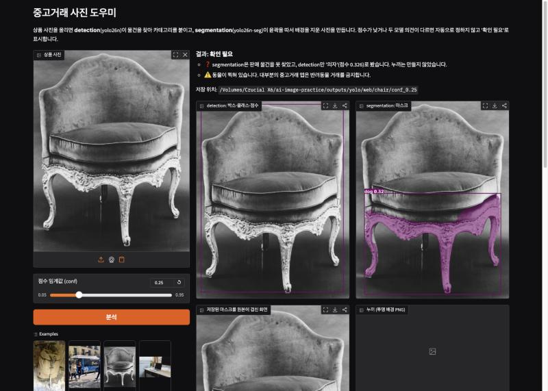
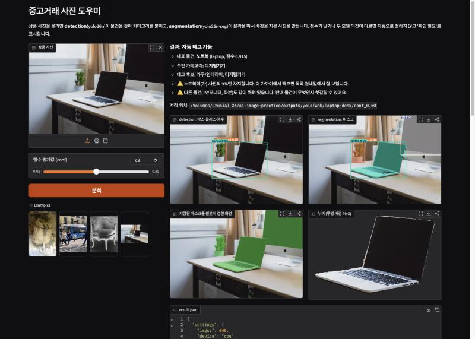
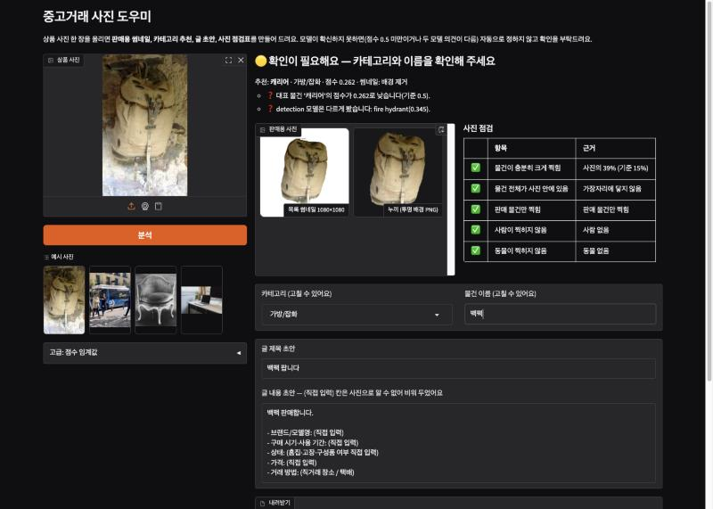

# 중고거래 사진 도우미

모두의연구소 「AI가 이미지를 읽기까지」 05 실습 · 선택 과제 A (YOLO detection + segmentation)

상품 사진 한 장을 넣으면

1. **detection** (`yolo26n.pt`)이 물건을 찾아 박스·클래스·점수를 내고, 그 클래스를 **중고거래 카테고리**(디지털기기, 가구/인테리어, 가방/잡화 …)로 바꿔 태그를 붙인다.
2. **segmentation** (`yolo26n-seg.pt`)이 물건의 윤곽 마스크를 따서 배경을 지운 **누끼**(`cutout.png`, 투명 배경)와 흰 배경 사진(`cutout_white.jpg`)을 만든다.
3. 사진을 **점검표**로 보여 준다(근거 숫자와 함께).
   - 물건이 작게 찍힘(15% 미만)
   - 다른 물건이 함께 찍힘: 대표 물건의 부속, 예를 들어 노트북 자체의 키보드는 세지 않는다.
   - 가장자리에서 잘림
   - 사람(개인정보): **자동으로 흐린 `privacy_safe.jpg`** 를 만든다.
   - 동물(거래 금지): 두 모델이 모두 동물이라고 볼 때만 경고하고, 한쪽만 보면 '확인 필요'로 둔다.
4. 판매자에게 바로 쓸 결과를 준다.
   - **1080×1080 흰 배경 목록 썸네일** (`listing_thumb.jpg`)
   - **글 초안**: 제목, 카테고리, 태그, 본문. 브랜드·상태·가격처럼 사진으로 알 수 없는 것은 지어내지 않고 "(직접 입력)"으로 둔다.
5. 대표 물건 점수가 **0.5 미만**이거나 **두 모델의 의견이 다르면** 자동으로 정하지 않고 **'확인 필요'** 로 둔다. 이때 웹 화면에서 판매자가 카테고리와 물건 이름을 고치면 글 초안이 바로 바뀐다.
6. segmentation이 판매 물건을 못 찾고 detection만 찾았으면, 배경 제거 대신 **박스 영역을 잘라** 썸네일을 만든다(예: chair).

| 자동 태그 (초기 화면) | 확인 필요 (초기 화면) | conf 0.50 (초기 화면) | 판매자가 이름을 고침 (현재 화면) |
|---|---|---|---|
|  |  |  |  |

캡처 1~3은 판매자용 화면으로 바꾸기 전의 화면이다. 모델 결과(박스·마스크·점수)는 그때와 같다.

---

## 1. 실행 방법

```bash
# 1) 가상환경 (아래 '왜 내장 디스크에 venv를 두나' 참고)
python3.12 -m venv ~/.venvs/ai-image-practice
~/.venvs/ai-image-practice/bin/pip install -r requirements.txt

# 2) 명령줄: input/의 사진 4장을 conf 0.25 / 0.50 으로 돌리고 manifest.json 작성
~/.venvs/ai-image-practice/bin/python run.py
~/.venvs/ai-image-practice/bin/python run.py input/my-photo.jpg   # 사진 하나만

# 3) 노트북 (출력이 들어 있는 상태로 저장됨, 다시 실행하려면)
~/.venvs/ai-image-practice/bin/python -m jupyter nbconvert --to notebook --execute --inplace demo.ipynb

# 4) 웹 화면 → http://127.0.0.1:7860
~/.venvs/ai-image-practice/bin/python app.py
```

가중치 `models/yolo26n.pt`, `models/yolo26n-seg.pt` 는 저장소에 들어 있다(각 5.5 MB, 6.7 MB). 처음 실행해도 인터넷에서 받지 않는다.

**왜 내장 디스크에 venv를 두나.** 작업 폴더가 exFAT 외장 드라이브에 있다. macOS는 exFAT에 파일을 쓸 때마다 `._파일이름` 숨김 파일(리소스 포크)을 만든다. venv 안에 `._*.py`, `._*.dist-info` 가 생기면 pip/파이썬이 이것을 진짜 모듈·패키지 정보로 읽으려다 설치가 깨졌다. 그래서 venv는 내장 디스크 `~/.venvs/ai-image-practice` 에 두고, 코드·결과만 외장 드라이브에 둔다. 같은 이유로 코드에서 `input/` 을 읽을 때 `._` 로 시작하는 파일은 건너뛰고, 커밋 전에는 `find . -name '._*' -delete` 를 돌린다(`.gitignore` 에도 `._*` 가 있다).

## 2. 실행 위치와 도구·설정을 고른 이유

| 항목 | 값 | 이유 |
|---|---|---|
| 실행 위치 | **로컬 Mac (Apple Silicon, CPU)** — `manifest.json` 의 `run_location` | nano 모델 2개 × 사진 4장 × conf 2개라서 CPU로 사진 한 장에 몇 초면 끝난다. Colab은 세션이 끊기면 venv·결과를 다시 만들어야 하고, 판매자 개인 사진을 외부 서버에 올리지 않아도 된다. |
| 모델 | `yolo26n.pt` / `yolo26n-seg.pt` (COCO 80종, 추가 학습 없음) | 과제 지정. 같은 계열의 detection·segmentation을 나란히 돌려 서로 검증하게 했다. |
| `imgsz` | 640 | 두 모델이 학습된 입력 크기. 원본(1280px)은 640으로 줄여서 추론하고, 박스·마스크 좌표는 원본 픽셀로 되돌려 저장한다. |
| `device` | `cpu` | 과제 지정. 누구 컴퓨터에서나 같은 장치로 돌릴 수 있다. CPU로 같은 사진을 여러 번(명령줄·노트북·웹) 돌렸을 때 점수가 같았다. |
| `conf` | 0.25 와 0.50 | 0.25(Ultralytics 기본값)는 놓치는 것을 줄이고, 0.50은 틀린 박스를 줄인다. 두 값으로 **실제로 다시 돌려서** 사라지는 대상을 `compare.json` 에 기록했다. |
| '확인 필요' 기준 | 대표 물건 점수 < 0.50, 또는 detection과 segmentation이 같은 물건을 다른 클래스로 봄(같은 클래스·IoU≥0.5 박스가 없음) | 판매 글은 틀리면 손해가 크므로, 자신 없는 결과는 사람이 고르게 한다. |
| 대표 물건 고르기 | 마스크 면적 × 점수, 가장자리에 닿으면 ×0.5 | 처음에는 '마스크 면적 최대'로 골랐더니 laptop-desk에서 오른쪽 위에서 잘린 모니터를 대표로 골랐다(아래 4절). |
| 웹 화면 | Gradio | 슬라이더로 conf를 바꾸며 같은 사진을 바로 다시 볼 수 있다. |

## 3. 출력 구조

```
outputs/yolo/
├── manifest.json                 입력(출처·라이선스), 모델, 패키지 버전, 실행 위치, 설정
└── <사진이름>/
    ├── compare.json              conf별 개수, 0.25에서만 나온 대상, conf별 대표 물건
    ├── side_by_side.jpg          원본 | 0.25 | 0.50 (윗줄 detection, 아랫줄 segmentation)
    ├── conf_0.25/
    │   ├── detect.jpg            박스·클래스·점수
    │   ├── segment.jpg           마스크
    │   ├── mask_overlay.jpg      저장된 마스크 파일을 원본에 겹친 그림
    │   ├── masks/NN_<class>.png  원본 해상도 마스크 (0/255)
    │   ├── cutout.png            누끼 (투명 배경, 대표 물건이 있을 때만)
    │   ├── cutout_white.jpg      누끼 (흰 배경)
    │   ├── listing_thumb.jpg     목록 썸네일 1080×1080 (누끼, 또는 detection 박스 자르기)
    │   ├── privacy_safe.jpg      사람을 흐리게 처리한 사진 (사람이 있을 때만)
    │   └── result.json           박스(원본 픽셀 xyxy)·점수·마스크 면적·listing(상태·카테고리·경고)
    └── conf_0.50/ …
```

코드: `market_helper.py`(analyze / compare / write_manifest), `run.py`(명령줄), `app.py`(웹), `demo.ipynb`(노트북). 웹 화면 결과는 `outputs/yolo/web/` 에 따로 저장하고, 사용자가 올린 사진이 들어갈 수 있어 저장소에는 넣지 않는다.

## 4. 원본 대조 검토 기록

모든 좌표는 원본 픽셀 `[x1, y1, x2, y2]`, 출처는 각 폴더의 `result.json`. 판단은 `detect.jpg`, `mask_overlay.jpg` 를 원본과 나란히 놓고 눈으로 확인했다.

### bus.jpg (810×1080) — 판매 물건 없음, 사람 경고

- detection·segmentation 모두 bus 1 + person 4. **0.25와 0.50 결과가 같다**(가장 낮은 점수가 person 0.654).
- 왼쪽 가장자리에서 반쯤 잘린 사람도 **잡혔다**: person 0.654, 박스 `[0.2, 553.0, 59.7, 871.3]`, segmentation 마스크는 사진의 1.2%. 원본에서 보이는 사람 4명(왼쪽 잘린 1, 가운데 2, 오른쪽 잘린 1)이 모두 박스를 받았고, 빠진 사람은 확인되지 않았다.
  - 인계받은 메모에는 "왼쪽 잘린 사람이 미탐"이라고 되어 있었지만, 다시 원본과 `detect.jpg` 를 대조해 보니 박스가 있어서 이 기록을 고쳤다.
- bus는 중고거래 카테고리에 없어서 대표 물건이 없고 '확인 필요'. 사람 4명 → 개인정보 경고. 서비스 동작으로는 맞다.

### chair.jpg (1280×1653, 흑백 박물관 사진) — 확인 필요, 동물 경고는 거짓 경보

- detection: chair **0.326**, 박스 `[38.6, 25.4, 1231.6, 1600.5]` → 의자 전체를 맞게 감쌌다. 하지만 0.50에서는 사라진다.
- segmentation: **dog 0.319**, 박스 `[69.5, 772.6, 1212.7, 1619.5]`. 마스크(`mask_overlay.jpg`)를 보면 등받이·쿠션은 빠지고 조각된 다리와 앞 테두리만 칠해졌다. 다리를 동물 다리로 본 것으로 보인다.
- 결과: 판매 물건 마스크가 없어 누끼를 만들지 않고 '확인 필요'. 처음 버전은 동물 경고를 냈는데 **거짓 경보**였다(사진에 동물 없음).
- 고친 뒤: 동물은 두 모델이 모두 볼 때만 경고하고, segmentation만 dog로 봤으므로 "오인일 수 있음"으로 '확인 필요'에 넣는다. 썸네일은 detection 의자 박스를 잘라 만든다(배경은 그대로).

### backpack.jpg (1280×2122) — 클래스는 둘 다 틀림, 카테고리는 맞음

- detection: **fire hydrant 0.345** `[128.7, 89.8, 1105.4, 1629.7]`. segmentation: **suitcase 0.262** `[124.8, 318.3, 1107.7, 1735.3]`. 원본은 군용 배낭이므로 둘 다 틀렸다(COCO에는 backpack 클래스가 있는데도).
- suitcase가 '가방/잡화'로 묶여 있어서 **카테고리는 우연히 맞았다.** 그러나 점수 0.262 < 0.50, 두 모델 의견 다름 → '확인 필요'. 누끼는 만들었다.
- 마스크 윤곽은 가방 몸통(약 y 320–1735)을 잘 따랐다. 빠진 부분: 위쪽 고리(약 y 90–320, detection 박스에는 포함) — 가방 손잡이인지 벽에 걸린 끈인지는 사진만으로 확실하지 않다. 아래로 늘어진 두 줄의 끈(약 y 1735–2050)도 마스크에서 빠졌다. 마스크 위 끝(약 y 318)에 몸통과 떨어진 가는 띠 조각이 하나 있다.
- 0.50에서는 아무것도 나오지 않는다.

### laptop-desk.jpg (1280×853) — 자동 태그 가능, 경고 2개 중 하나는 일부 오경보

- 대표: segmentation **laptop 0.915** `[404.6, 257.0, 939.9, 605.1]`, detection laptop 0.936 과 일치 → '자동 태그 가능', 카테고리 디지털기기. 누끼 윤곽은 화면·본체 모두 깔끔하다.
- **고친 오류:** 처음 규칙(마스크 면적 최대)으로는 tv 0.833 `[891.3, 1.5, 1279.7, 380.3]`(마스크 12.0%)가 laptop(9.0%)보다 커서 대표로 뽑혔다. 이 모니터는 사진 위·오른쪽 가장자리에서 잘린 배경 물건이다. '가장자리 감점 ×0.5 + 점수×면적'으로 바꾼 뒤 노트북을 고른다.
- tv(detection 0.385)와 keyboard(detection 0.314 / segmentation 0.278)는 **0.25에서만** 나온다(`compare.json`). tv는 segmentation에서는 0.833이라 0.50에서도 남는다.
- 경고 "사진의 9%만 차지": 마스크 면적비 0.0896 — 맞다.
- 경고 "다른 물건(TV/모니터, 키보드, 화분)": TV와 화분은 실제로 따로 있는 물건이다. 그러나 **keyboard 박스 `[400.3, 483.6, 859.7, 603.3]` 는 노트북 자체의 키보드**다(노트북 박스 안쪽). 별도 키보드는 없으므로 처음 버전에서 '키보드'는 오경보였다.
- 고친 뒤: 다른 물건의 마스크가 대표 물건 마스크 안에 50% 이상 들어 있으면 '부속'으로 보고 뺀다(`parts_of_main: ["keyboard"]`). 이제 경고는 "TV/모니터, 화분"이다. 화분은 박스로는 노트북 박스 안에 96% 들어가지만 마스크는 겹치지 않아서 부속으로 잘못 빠지지 않는다. 그래서 박스가 아니라 마스크로 판단했다.
- 모니터 마스크는 화면만 칠하고 스탠드·아래 턱은 빠졌다.

### 웹 화면과 명령줄 결과가 달랐던 문제 (고침)

- 웹에서 chair를 올리면 chair **0.297**, dog 0.393 이 나왔다(명령줄은 0.326 / 0.319). 기록: `docs/evidence/chair_before_fix_jpeg_recompressed_0.297.jpg`.
- 원인: Gradio `gr.Image` 의 기본값 `image_mode="RGB"`. chair.jpg는 흑백(L 모드)이라 Gradio가 RGB로 바꾼 뒤 **JPEG로 다시 저장**했고, 원본과 픽셀이 최대 23 차이 났다. Gradio 임시 폴더의 `chair.jpeg` 를 원본과 비교해 확인했다(MD5 다름).
- 처음 시도한 `format="png"` 는 효과가 없었다. Gradio 6.31 소스(`image_utils.preprocess_image`)를 보면 업로드에는 원래 확장자를 쓰고 `format` 은 무시한다.
- `image_mode=None` 으로 바꾸자 Gradio가 원본 파일을 그대로 넘겼고, 웹에서도 chair 0.326 / dog 0.319 로 명령줄과 같아졌다(`02_chair_needs_review.jpg` 는 고친 뒤 다시 찍음). 컬러 사진 3장은 처음부터 RGB라 영향이 없었다.

## 5. 예상과 실제

| 사진 | 예상 | 실제 |
|---|---|---|
| bus | 사람·버스는 잘 잡힘, 잘린 사람은 놓칠 수 있음 | 잘린 사람까지 5개 모두 잡힘. 0.25 = 0.50 |
| chair | 흔한 물건이라 chair로 높은 점수 | 흑백·장식 많은 골동품이라 0.326, segmentation은 dog |
| backpack | backpack | 둘 다 다른 클래스(fire hydrant / suitcase), 카테고리만 맞음 |
| laptop-desk | 노트북 자동 태그 | 맞음. 다만 대표 고르기 규칙을 한 번 고쳐야 했고, 노트북 키보드를 별도 물건으로 셈 |
| 0.25 → 0.50 | 오탐이 줄어듦 | laptop-desk의 tv·keyboard(그중 keyboard는 오탐)가 빠짐. 대신 chair·backpack은 맞는 물건도 전부 사라짐 |

정리하면 **0.50은 '확실한 것만 자동 처리'에 맞고, 0.25는 '후보를 보여 주고 사람이 고르는' 화면에 맞다.** 그래서 서비스는 0.25로 후보를 보여 주되 0.50 미만이면 '확인 필요'로 표시한다.

## 6. 확인이 필요한 것과 한계 (추측을 결과로 쓰지 않기)

- 검증한 사진은 **4장뿐**이다. 정확도·재현율 같은 수치를 낼 만큼의 평가는 하지 않았다. 위 판단은 사진별 눈 확인이다.
- 정답 박스(라벨)를 따로 만들지 않았다. "맞다/틀렸다"는 원본 사진을 보고 내린 판단이고, 좌표는 모델 출력이다.
- 모델은 COCO 80종만 안다. 옷, 신발, 화장품, 게임기 등 중고거래에서 흔한 물건 상당수는 **클래스 자체가 없다**. 카테고리 표(`CATEGORY`)는 내가 정한 대응이며 실제 중고거래 앱의 분류와 같다는 근거는 없다.
- '사진의 15% 미만이면 작다'는 기준은 썸네일을 생각해 정한 값이고, 실험으로 정한 값이 아니다.
- 동물 경고는 두 모델이 같이 틀리면 여전히 거짓 경보가 난다. 사람 흐림은 사진 속 포스터·화면 속 사람도 흐린다.
- '부속' 판단(마스크 50% 이상 겹침) 기준은 laptop-desk 한 장으로 정했다. 다른 사진에서는 시험하지 않았다.
- 글 초안의 물건 이름은 모델 클래스를 그대로 쓴다. backpack처럼 클래스가 틀리면 "캐리어 팝니다"가 나오므로 판매자가 고쳐야 한다(웹 화면에서 고칠 수 있음).
- 목록 썸네일은 작게 찍힌 물건(laptop 9%)을 크게 늘리므로 흐릿해질 수 있다.
- 누끼 품질은 마스크(640 해상도에서 만든 폴리곤)를 그대로 쓴다. 끈·고리처럼 가는 부분은 빠지기 쉽고, 경계 다듬기(matting)는 하지 않았다.
- CPU에서만 돌렸다. GPU/MPS에서는 점수가 소수점 셋째 자리에서 조금 다를 수 있다(확인하지 않음).

## 7. 출처와 라이선스

| 파일 | 출처 | 라이선스 |
|---|---|---|
| `input/bus.jpg` | Ultralytics 패키지 예제 (`ultralytics/assets/bus.jpg`) | Ultralytics 저장소 예제 자산(AGPL-3.0 저장소), 과제 지정 예제 |
| `input/chair.jpg` | [Wikimedia Commons: Desk chair MET 211351](https://commons.wikimedia.org/wiki/File:Desk_chair_MET_211351.jpg) (The Metropolitan Museum of Art) | CC0 1.0, 1280px 축소본 |
| `input/laptop-desk.jpg` | [Wikimedia Commons: Laptop on a neat desk (Unsplash)](https://commons.wikimedia.org/wiki/File:Laptop_on_a_neat_desk_(Unsplash).jpg) | CC0 1.0, 1280px 축소본 |
| `input/backpack.jpg` | [Wikimedia Commons: Military backpack 01](https://commons.wikimedia.org/wiki/File:Military_backpack_01.jpg) | CC0 1.0, 1280px 축소본 |

같은 내용이 `input/SOURCES.json` 과 `manifest.json` 의 `inputs` 에 들어 있다.

**AGPL-3.0 메모.** Ultralytics 패키지와 YOLO26 가중치는 AGPL-3.0이다. 이 저장소는 그것을 불러 쓰고 가중치를 함께 배포하므로, 공개할 때 소스 전체를 공개하고 같은 조건(AGPL-3.0)을 따라야 한다. 특히 이 서비스를 웹으로 다른 사람에게 제공하면 그 사용자에게도 소스를 공개해야 한다. 상업 서비스로 쓰려면 Ultralytics Enterprise 라이선스가 필요하다. 이 과제는 교육용으로 소스를 공개하는 것을 전제로 한다.
